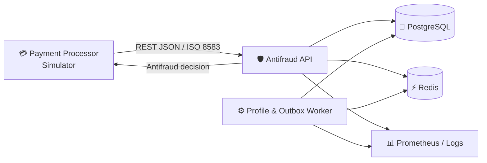

<div align="center">

# 🛡️ VigilantGo

### Монолитная антифрод-система для банковских транзакций

Приём и анализ транзакций, управление профилями и вынесение решений в режиме реального времени.


</div>

---

## 📋 Содержание

- [О проекте](#-о-проекте)
- [Возможности](#-возможности)
- [Технологический стек](#-технологический-стек)
- [Архитектура](#-архитектура)
- [Быстрый старт](#-быстрый-старт)
- [Проверка состояния](#-проверка-состояния)
- [Структура проекта](#-структура-проекта)
- [Полезные команды](#-полезные-команды)
- [Планы развития](#-планы-развития)

## 🔍 О проекте

**VigilantGo** — монолитная антифрод-система, предназначенная для отслеживания, анализа и вынесения вердиктов по банковским транзакциям.

Сервис принимает транзакции от платёжного процессинга, анализирует их с использованием данных из PostgreSQL и Redis, после чего возвращает решение вызывающей системе.

> Проект находится в активной разработке. API и структура компонентов могут изменяться.

## ✨ Возможности

- ⚡ обработка транзакций в режиме реального времени;
- 🔎 анализ транзакционных и профильных данных;
- ⚖️ вынесение антифрод-решений;
- 🚀 кеширование и хранение оперативных данных в Redis;
- 🗄️ долговременное хранение данных в PostgreSQL;
- 📦 обработка профилей и событий через worker;
- ❤️ эндпоинты для проверки состояния приложения;
- 📊 подготовленная интеграция с метриками и логированием;
- 🐳 запуск локального окружения через Docker Compose.

## 🧰 Технологический стек

| Технология | Назначение |
|---|---|
| [Go](https://go.dev/) | Основной язык приложения |
| [chi](https://github.com/go-chi/chi) | HTTP-маршрутизация |
| [PostgreSQL](https://www.postgresql.org/) | Основное хранилище данных |
| [pgx](https://github.com/jackc/pgx) | Драйвер и инструменты для PostgreSQL |
| [Redis](https://redis.io/) | Кеш и оперативное хранилище |
| [go-migrate](https://github.com/golang-migrate/migrate) | Управление миграциями базы данных |
| [Docker Compose](https://docs.docker.com/compose/) | Запуск локального окружения |

## 🏗 Архитектура



### Основные компоненты

- **Payment Processor / Simulator** — источник банковских транзакций.
- **Antifraud API** — принимает транзакции, выполняет анализ и возвращает решение.
- **Profile & Outbox Worker** — обрабатывает профильные данные и фоновые события.
- **PostgreSQL** — хранит транзакции, профили и результаты обработки.
- **Redis** — используется для кеширования и быстрого доступа к данным.
- **Prometheus / Logs** — наблюдаемость, метрики и журналирование.

## 🚀 Быстрый старт

### Требования

Перед запуском убедитесь, что установлены:

- [Docker](https://docs.docker.com/get-docker/);
- [Docker Compose](https://docs.docker.com/compose/);
- Git.

### 1. Клонируйте репозиторий

```bash
git clone https://github.com/danilpashin/VigilantGo.git
cd VigilantGo
```

### 2. Настройте переменные окружения

Скопируйте пример конфигурации:

```bash
cp .env.example .env
```

При необходимости измените значения переменных в `.env`.

> Не добавляйте файл `.env` с секретами в систему контроля версий.

### 3. Запустите приложение

```bash
docker compose up -d
```

### 4. Проверьте контейнеры

```bash
docker compose ps
```

### 5. Посмотрите логи

```bash
docker compose logs -f
```

После запуска API будет доступен по адресу:

```text
http://127.0.0.1:8000
```

## ❤️ Проверка состояния

### Liveness

Проверяет, что API запущен и способен принимать запросы:

```text
GET http://127.0.0.1:8000/health/live
```

Проверка через `curl`:

```bash
curl --fail http://127.0.0.1:8000/health/live
```

### Readiness

Проверяет готовность API и доступность зависимостей — PostgreSQL и Redis:

```text
GET http://127.0.0.1:8000/health/ready
```

Проверка через `curl`:

```bash
curl --fail http://127.0.0.1:8000/health/ready
```

| Эндпоинт | Назначение |
|---|---|
| `/health/live` | Проверка работоспособности API |
| `/health/ready` | Проверка готовности PostgreSQL и Redis |

## 📁 Структура проекта

```text
VigilantGo/
├── .dockerignore
├── AGENTS.md
├── cmd/
│   └── api/
│       └── main.go
├── internal/
│   ├── cache/
│   │   └── cache.go
│   ├── database/
│   │   └── database.go
│   ├── logging/
│   │   └── logger.go
│   └── platform/
│       └── config/
│           └── config.go
├── docker-compose.yml
├── Dockerfile
├── go.mod
├── go.sum
├── Makefile
└── README.md
```

### Назначение директорий

| Путь | Описание |
|---|---|
| `cmd/api` | Точка входа HTTP API |
| `internal/cache` | Работа с Redis и кешем |
| `internal/database` | Подключение и работа с PostgreSQL |
| `internal/logging` | Настройка журналирования |
| `internal/platform/config` | Загрузка и валидация конфигурации |

## 🛠 Полезные команды

### Запустить сервисы

```bash
docker compose up -d
```

### Пересобрать образы и запустить сервисы

```bash
docker compose up -d --build
```

### Посмотреть логи

```bash
docker compose logs -f
```

### Остановить сервисы

```bash
docker compose stop
```

### Остановить и удалить контейнеры

```bash
docker compose down
```

### Остановить сервисы и удалить локальные тома

> ⚠️ Команда удалит данные PostgreSQL и Redis, сохранённые в Docker volumes.

```bash
docker compose down -v
```

### Запустить тесты

```bash
go test ./...
```

### Проверить форматирование

```bash
gofmt -w .
```

## 🗺 Планы развития

- [ ] расширяемый набор антифрод-правил;
- [ ] поддержка скоринговой модели;
- [ ] журнал решений и аудит транзакций;
- [ ] обработка событий через Outbox Pattern;
- [ ] метрики Prometheus;
- [ ] трассировка запросов;
- [ ] нагрузочные и интеграционные тесты;
- [ ] OpenAPI/Swagger-документация;
- [ ] симулятор платёжного процессинга.

---

<div align="center">

Сделано на Go для быстрого и надёжного анализа транзакций 🛡️

</div>